# HOS: E-commerce Mobile App (Flutter + Laravel)


A full-stack e-commerce platform built from scratch: a Flutter mobile app (about 22 screens) for customers and store admins, backed by a Laravel REST API. It covers the whole shopping flow, from browsing products to online payment and order tracking, plus an admin area for managing the store.

**Repositories:** Mobile app (this repo) | [Backend API (Laravel)](https://github.com/Hossam-5555/example-app)

> **Note:** These repositories are shared for viewing and evaluation only. See [License](#license).

## Screenshots

| Splash | Login | Home | Items | Item details |
|:---:|:---:|:---:|:---:|:---:|
| 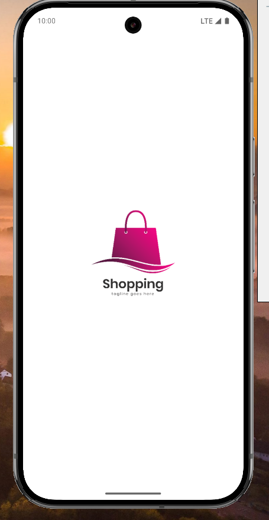 | 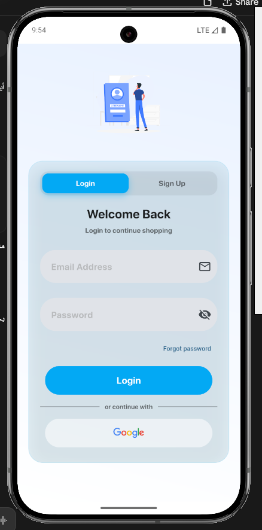 | 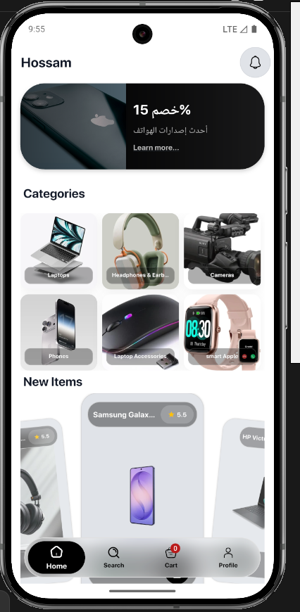 | 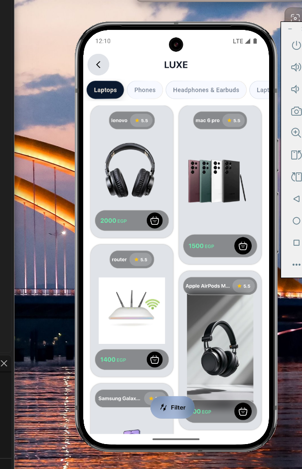 | 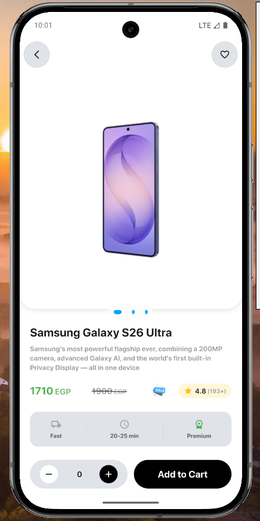 |

| Search | Cart | Checkout | Maps | Orders |
|:---:|:---:|:---:|:---:|:---:|
| 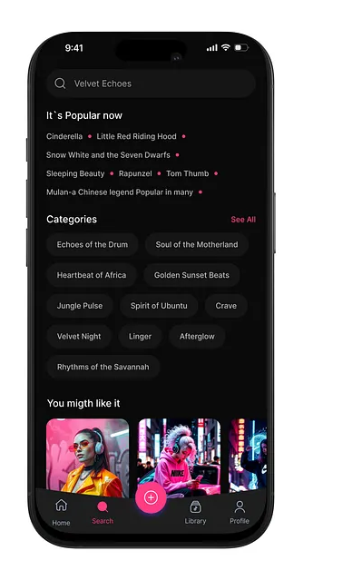 | 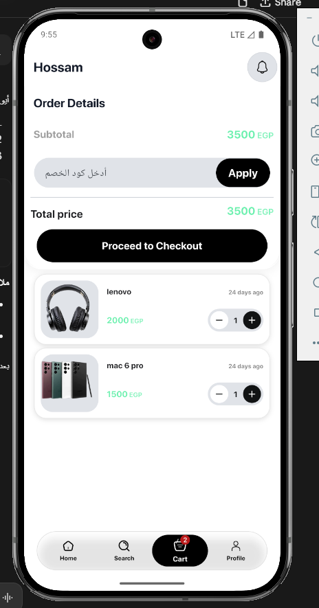 | 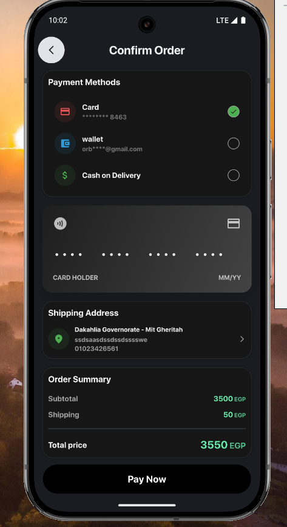 | 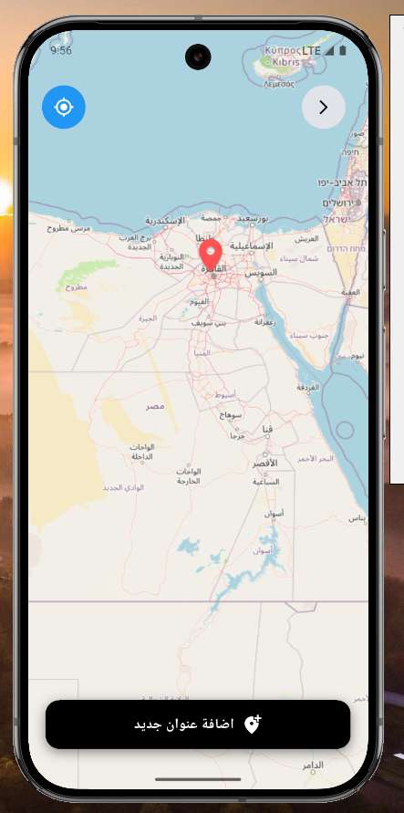 | 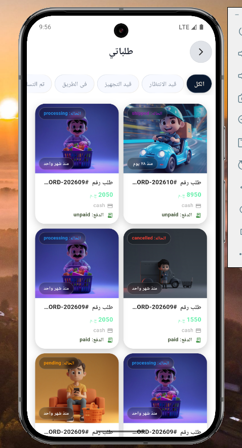 |

| Order details | Notifications | Profile |
|:---:|:---:|:---:|
| 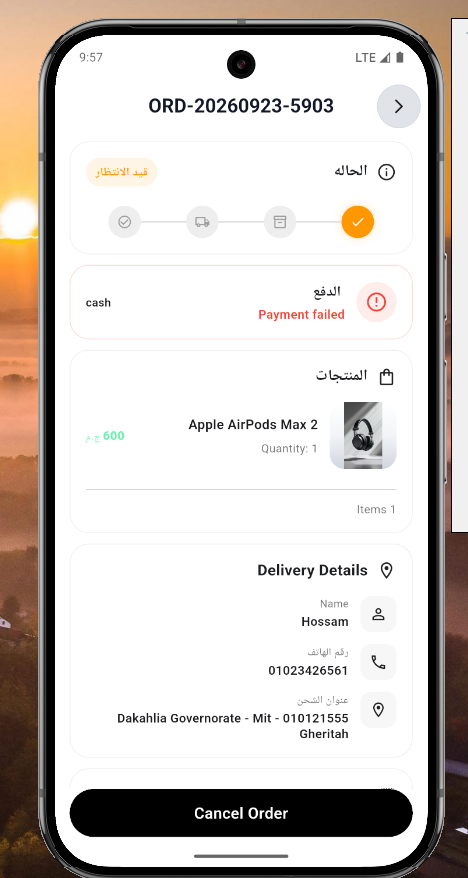 | 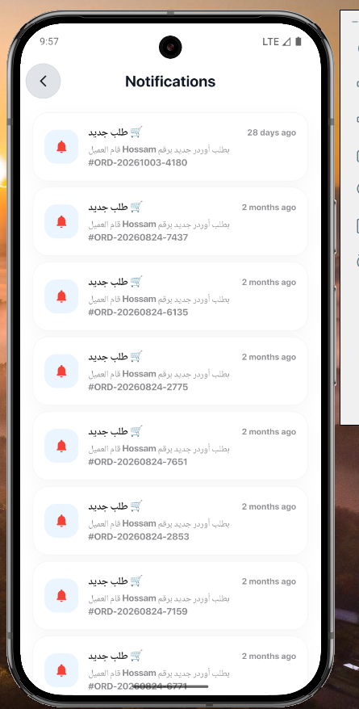 | 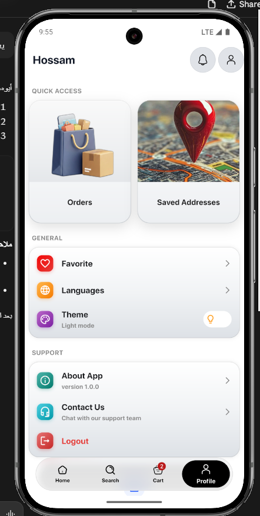 |

## Features

### Customer app
- Browse products and categories, search, and filter
- Favorites and shopping cart
- Multiple delivery addresses with a default address, and Google Maps integration
- Secure checkout with online payment (Paymob), including payment status tracking
- Order history and real-time order status
- Push notifications with Firebase Cloud Messaging
- Arabic and English, light and dark theme, responsive layouts for phones and tablets

### Admin area (role-based)
- Analytics dashboard: sales, active products, and customers
- Order management with status updates and admin notifications (FCM with deep linking)
- Coupon management: create, list, activate/deactivate, delete
- Brand management: create, edit, delete, with business rules (a brand that still has products cannot be deleted)

## Tech Stack

| Layer | Technologies |
|---|---|
| Mobile | Flutter, Dart, GetX (state management, routing, localization) |
| Backend | Laravel (PHP), REST API, Laravel Sanctum, API Resources, service classes |
| Database | MySQL |
| Services | Firebase (Cloud Messaging), Google Maps, Paymob payments |
| Tooling | Git, GitHub, Android Studio, VS Code, Postman |

## Architecture

The app follows an MVC-style structure with GetX controllers:

```
lib/
├── controler/      # GetX controllers (customer and admin)
├── core/           # HTTP client (Crud), status handling, shared helpers, services
├── data/
│   ├── datasource/ # API calls, one class per feature
│   └── model/      # Data models parsed from JSON
└── veiw/
    ├── screen/     # Pages
    └── wedget/     # Reusable widgets
```

**Request flow:** View → GetX Controller → Data source (`Crud`) → Laravel API.

- Loading, error, no-internet, and empty states go through one shared `Statusrequest` enum and a reusable `HandlingDataView` widget, so every screen behaves consistently.
- The API always responds in the same shape:

```json
{ "status": true, "message": "Success", "data": {} }
```

- On the backend, admin endpoints are protected by Sanctum authentication plus an admin role middleware. Rate limiting is applied on sensitive routes, and payments are confirmed through a server-side webhook.

## Getting Started

### Prerequisites
- Flutter SDK (stable) and Android Studio or VS Code
- PHP 8.2+, Composer, and MySQL for the backend
- A Firebase project and a Google Maps API key

### 1. Backend (Laravel)

The API lives in its own repository: [Hossam-5555/example-app](https://github.com/Hossam-5555/example-app).

```bash
git clone https://github.com/Hossam-5555/example-app.git hos-backend
cd hos-backend
composer install
cp .env.example .env
php artisan key:generate
# set your database credentials and Paymob keys in .env
php artisan migrate
php artisan serve
```

### 2. Mobile app (Flutter)

```bash
git clone https://github.com/Hossam-5555/hos.git
cd hos
flutter pub get
```

Then configure these (none of them are committed to the repository):

1. **API URL:** set `lravelserver` in the links class to your backend URL. On the Android emulator, use `http://10.0.2.2:8000/api`. On a physical device, use your computer's IP and run `php artisan serve --host=0.0.0.0`.
2. **Firebase:** add your own `google-services.json` to `android/app/`.
3. **Google Maps:** add your API key to `android/app/src/main/AndroidManifest.xml`.

```bash
flutter run
```

### 3. Admin account

Admin screens are available to users whose `users_type` is `admin` and `is_aprove` is `1` in the `users` table.

## Roadmap

- [ ] Apply coupon codes at checkout (validation and discount calculation)
- [ ] Link brands to categories from the admin brand form
- [ ] Edit existing coupons
- [ ] Automated tests

## License

Copyright (c) 2026 Hossam Yasser Elmonged. **All rights reserved.**

The source code is available for viewing and evaluation only. Copying, modifying, redistributing, or reusing it in other projects is not permitted without written permission. See [LICENSE](LICENSE).

## Author

**Hossam Yasser Elmonged**, Flutter & Laravel developer, final-year Computer Science student at Mansoura University.

- LinkedIn: [linkedin.com/in/hossam-yasser-a52108368](https://linkedin.com/in/hossam-yasser-a52108368)
- GitHub: [@Hossam-5555](https://github.com/Hossam-5555)